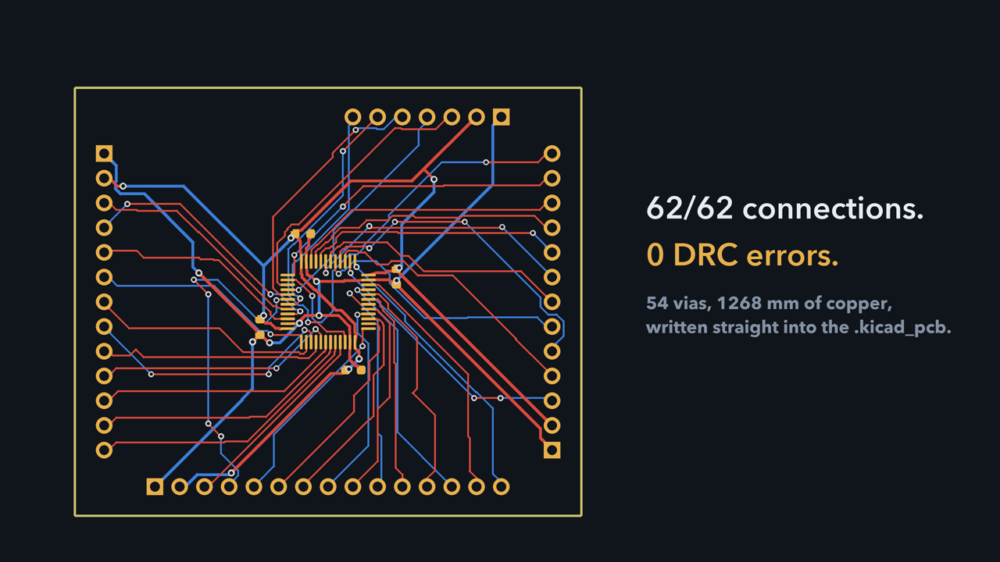
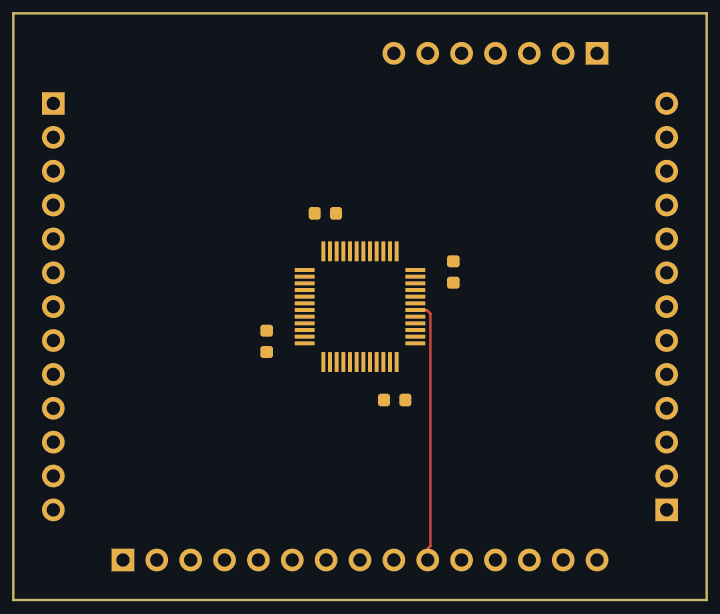
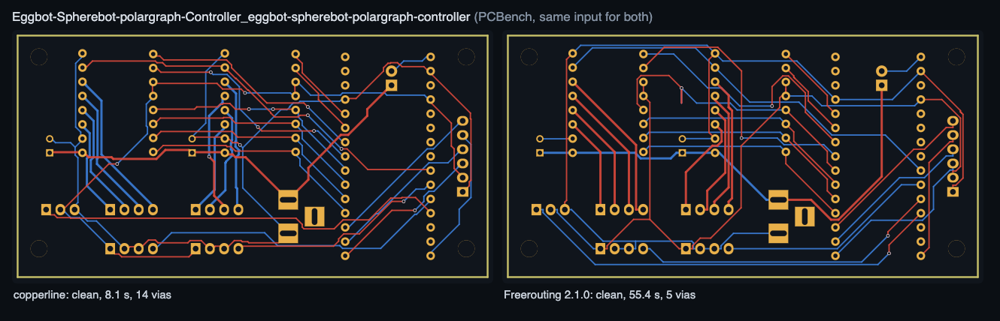

# copperline

[](assets/launch.mp4)

A PCB autorouter written from scratch in Rust: it reads a KiCad 9 board, routes every
connection on a grid with negotiated congestion (PathFinder), checks the result against
exact copper geometry, and writes plain KiCad tracks and vias back into the file. It also
compiles to a 440 KB WebAssembly module, so the [browser demo](https://thewingthewong.github.io/copperline/web/)
routes boards on your machine with no server.



<!-- headline:start -->
On 86 real open-hardware boards of medium size that it never saw during development, routed one at a time with the same input files and scored by KiCad 9's own DRC, copperline produces **94% clean boards against Freerouting's 66%** (71% if Freerouting is forgiven the errors KiCad's DSN export causes), with a median of 2.2 s per board against 20 s. On 90 hard boards it routes 80% clean (median 14 s) with a deterministic effort budget.
<!-- headline:end -->


## Try it

```sh
cargo install --git https://github.com/TheWingTheWong/copperline
copperline route board.kicad_pcb -o board-routed.kicad_pcb
```

The design rules are read from `board.kicad_pro` next to the board (net classes, track
widths, clearances, via sizes, board minimums). Without it, KiCad's defaults apply. The
output is the input file byte for byte, with the new `segment` and `via` items appended
before the final parenthesis, so it opens in KiCad 9 and diffs cleanly.

A board that ships with the repo:

```sh
cargo run --release -- route examples/mcu48.kicad_pcb -o /tmp/mcu48-routed.kicad_pcb --stats /tmp/stats.json
```

```
pitch 0.087 mm, 42 nets, 62/62 connections, 18 iterations, 544 tracks, 54 vias, 1267.9 mm, 5440 ms
```

`scripts/check_examples.sh` routes both bundled boards and scores them with `kicad-cli`
(both come back with zero violations and zero unconnected items).

The browser demo in `web/` is static; rebuild its module with
`cargo build --release --lib --target wasm32-unknown-unknown && cp target/wasm32-unknown-unknown/release/copperline.wasm web/`
(CI builds the same target on every push).

Other commands: `copperline info` (what the parser saw), `copperline svg` and
`copperline render` (pictures of a board), `--frames DIR` on `route` (one image per
routing step; `scripts/animate.sh` turns them into the GIF above).

## Results

<!-- results:start -->
#### Head to head, one board at a time (current build)

| tier | boards | copperline clean | Freerouting clean | Freerouting, conversion artifacts forgiven | copperline median / p90 s | Freerouting median / p90 s | both clean | only copperline | only Freerouting |
|---|---:|---:|---:|---:|---:|---:|---:|---:|---:|
| medium, held out | 86 | 81/86 = 0.94 [0.87, 0.97] | 57/86 = 0.66 [0.56, 0.75] | 61/86 = 0.71 [0.61, 0.79] | 2.2 / 11.6 | 20.1 / 224.7 | 55 | 26 | 2 |

| copperline alone | boards | clean | median / p90 / max s |
|---|---:|---:|---:|
| hard, held out | 90 | 72/90 = 0.80 [0.71, 0.87] | 14.1 / 174.3 / 281 |

copperline build for these rows: bench-freeze-36-g6f14213, bench-freeze-39-g8c71e41-dirty, default effort budget.

#### Earlier run: frozen build, both routers sharing a loaded laptop

| tier | boards | copperline clean | Freerouting clean | Freerouting, conversion artifacts forgiven | copperline median / p90 s | Freerouting median / p90 s | both clean | only copperline | only Freerouting |
|---|---:|---:|---:|---:|---:|---:|---:|---:|---:|
| easy (seen in dev) | 96 | 96/96 = 1.00 [0.96, 1.00] | 81/96 = 0.84 [0.76, 0.90] | 85/96 = 0.89 [0.81, 0.93] | 0.4 / 2.2 | 22.1 / 63.6 | 81 | 15 | 0 |
| medium, held out | 86 | 79/86 = 0.92 [0.84, 0.96] | 56/86 = 0.65 [0.55, 0.74] | 59/86 = 0.69 [0.58, 0.77] | 3.0 / 18.8 | 33.5 / 541.3 | 54 | 25 | 2 |
| hard, held out | 90 | 52/90 = 0.58 [0.47, 0.67] | 36/90 = 0.40 [0.30, 0.50] | 36/90 = 0.40 [0.30, 0.50] | 83.6 / 414.9 | 600 (cap) / 600 (cap) | 31 | 21 | 5 |

#### copperline on every board of each tier (not only those Freerouting finished)

| tier | boards routed | clean | boards where KiCad found errors in copperline's copper |
|---|---:|---:|---:|
| easy (seen in dev) | 96 | 96/96 = 1.00 [0.96, 1.00] | 0 |
| medium, held out | 86 | 79/86 = 0.92 [0.84, 0.96] | 1 |
| hard, held out | 90 | 52/90 = 0.58 [0.47, 0.67] | 1 |

copperline's own DRC vs KiCad: KiCad found errors in copperline's copper on 2 of 861 routed board runs (0282_WordClock_v2.0_WordClock_v2, 0595_LoRaPP_loramod).

#### Parity with PCBWorld's published Freerouting run (D3-A)

PCBWorld (RQ2 table, d3a fair-95 subset, Freerouting 2.1.0, mean of 4 seeds) reports mean DRC violations 0.09 on fully routed boards and routability 0.98 (mean fraction of nets routed). Clean-pass is not published, so this compares what can be compared:

- our single-seed run on test-a: routability 0.97 (PCBWorld: 0.98), mean DRC violations on fully routed boards 0.15 (PCBWorld: 0.09; ours includes the DSN-conversion artifacts above), 85/96 boards fully routed
- clean-pass of our run: 81/96


The slowest completed held-out copperline run took 1774 s; the frozen build ran into the bench's 1800 s cap on 0672_DAC-ADAU1966_DAC-ADAU1966, because its time budget was only checked between negotiation passes (it is a deadline since; see Limitations).
<!-- results:end -->

**Setup.** Every board in these tables is a real open-hardware design from
[PCBench](https://github.com/PCBench/PCBench), prepared with
[PCBWorld](https://github.com/LGAI-Research/PCBWorld)'s own pipeline (the D3 benchmark):
the original routing is stripped, each net keeps the width its designer used, and the
project's design rules come along in the `.kicad_pro`. Both routers get the same files. A
board is **clean** when KiCad 9's DRC (`kicad-cli pcb drc`, error severity) reports zero
unconnected items and zero violations: PCBWorld's clean-pass. Freerouting 2.1.0 runs as
PCBWorld runs it (`-mp 10`, headless, default seed) through KiCad's DSN export and SES
import, with a 600 s cap per board. Rates carry Wilson 95% intervals; "both / only" count
the boards each router got clean.

**The two runs.** The head-to-head table is the one to trust. It uses the current build,
whose stopping point is a deterministic effort budget (A* expansions), so its result for a
board does not depend on machine load. Freerouting ran one board at a time on an otherwise
quiet laptop, alongside the copperline run as the only other process. Freerouting was not
rerun on the hard tier, because at up to 10 minutes a board that takes most of a day. The
earlier run below used the frozen build, whose budget was wall-clock time, with both
routers and several of their copies sharing a loaded laptop. The load slowed both by large
factors (board 0602 took the frozen copperline 313 s in that run and 7.6 s on a quieter
machine). Its times and its hard-tier rates are therefore indicative only, and they are
kept because that run was the held-out one: it was made once, before any of the fixes
below.

**Why Freerouting loses boards.** On medium boards it mostly stops with a connection or
two unrouted after PCBWorld's `-mp 10` passes; on hard boards it mostly runs out of time.
Its DRC errors are mostly not routing mistakes: KiCad's DSN export carries no copper text
and no footprint-level clearance overrides, and the SES that comes back has widths rounded
to the DSN resolution. `bench/classify.py` labels every KiCad error by cause, and the
"conversion artifacts forgiven" column counts a fully connected Freerouting board as clean
when all its errors are of those kinds. The plain column is what a user of the
KiCad-Freerouting round trip gets. copperline reads the `.kicad_pcb` directly and sees the
text and the overrides: an advantage of the approach, not cleverer routing.

**Where copperline fails.** It leaves connections out. It checks its copper with its own
exact DRC before writing and drops whatever fails. KiCad found errors in copperline's
copper on two boards of the frozen run, both bugs in that DRC, since fixed with tests: a
plated through-hole pad listing only F.Cu (KiCad treats it as copper on every layer), and
two tracks 0.1493 mm apart that fell into different buckets of the DRC's spatial index.

**Provenance.** Rows written since the `commit` column was added name the copperline build
that produced them. The frozen run predates it; `target/release` was built only from
commits whose `src/` matches `bench-freeze` until that run ended (`git diff bench-freeze
1de4fa8 -- src` is empty). Board 0498 is dropped for both routers: KiCad 9's
`ImportSpecctraSES` rejects Freerouting's session file for it. Per-board results are in
[`bench/results/per-board.md`](bench/results/per-board.md).

Three held-out boards side by side (left copperline, right Freerouting, same input file;
solid blocks are copper text, drawn as the boxes copperline keeps clear of). On the second
and third, Freerouting's errors are its tracks crossing copper text it was never shown.




Every number in this section is written by `python3 bench/report.py` from the per-board
CSVs in `bench/results/` (and into `bench/results/summary.md`). Times are each router's
own wall time per board on an 8 GB Apple M-series laptop; for Freerouting this includes JVM
start (about 1 s). DSN export, SES import and KiCad's DRC are not counted. The frozen run
started with PCBWorld's 1800 s cap for Freerouting and moved to 600 s part way through the
hard tier, once Freerouting had returned no clean board after 600 s in 15 runs; copperline
kept 1800 s there and went past 600 s on 4 hard boards, none of them clean, so the
uneven cap changes no result. PCBWorld also reports a best-of-4-seeds Freerouting number,
which neither run attempts.

### A note on the benchmark's splits

PCBWorld ships D3 as train and test splits, but every test board is also a train board:
the easy test split is the easy train split (99 of 99), and all 10 medium and all 10 hard
test boards appear in the corresponding train lists too (check: `bench/d3_pcbworld.json`).
Anyone tuning on train and reporting on test is reporting on boards they have seen.
copperline was developed on the train pools, so before writing any router code
`bench/splits.py` sealed 86 medium and 92 hard train boards (seed 20261110). Those sealed
boards are the **held-out** tiers above; the test boards add nothing held out, since they
all sit in the development pools or in the sealed sets. The easy tier was seen during
development and is labelled that way.

5 of the 796 D3 board folders could not be rebuilt by the prep chain on this machine
(0001, 0002, 0030, 0564, 0647) and are left out for both routers.

## How it works

**Parsing.** A small S-expression reader loads the `.kicad_pcb`: copper layers, nets,
footprints with pads (circle, rect, roundrect, oval, trapezoid, chamfered and custom pads,
each turned into exact shapes: points, capsules and polygons with a rounding radius), drill
holes, the board outline from Edge.Cuts (lines, arcs, circles, polygons, including those
inside footprints), rule-area keepouts, existing copper and copper text. Text is boxed
with the real advance widths of KiCad's stroke font, measured from pcbnew.

**Rules.** Net classes and patterns, track widths, clearances, via sizes, copper-to-edge,
hole clearance and hole-to-hole come from the `.kicad_pro`, along with pad- and
footprint-level clearance overrides.

**Grid and masks.** Each copper layer becomes a grid (pitch from the narrowest
width + clearance, typically 0.06 to 0.1 mm). For every net class, a mask records per cell
whether a track centreline of that class may sit there: free, owned by one net (inside
that net's clearance halo, so only that net may pass), or blocked. The mask is built from
exact distances to the real shapes, inflated by half the track width, the larger of the two
clearances, and a margin of 0.71 of a grid step, which is the furthest a straight or
diagonal grid move strays from a cell centre. A second mask per class does the same for via
centres, across all layers and with hole rules.

**Pads.** A pad is reached through its rim cells, or through a short exact stub from the
pad centre to a nearby grid node. Fine-pitch pads (0.5 mm QFP, QFN, FPC and USB-C rows)
leave straight along their axis before bending onto the grid, because an angled stub
clips the neighbouring pads. Every stub is checked against the exact geometry before it
is offered to the search.

**Routing.** Each net is grown as an approximate Steiner tree: a multi-source A* runs from
everything already connected to the nearest unconnected pad, with 8-way moves, through
vias between layers, a mild per-layer direction preference and a bend cost. The search
stays inside a window around the connection first, with a heuristic weight of 1.25.

**Negotiation.** In the first pass, nets may overlap. Every routed net stamps a halo into
an occupancy grid per net class. After each pass, a cell used by more than one net raises
its history cost, the present-congestion factor grows (capped), and only the nets in
conflict are ripped up and rerouted. This repeats until nothing overlaps (McMurchie and
Ebeling's PathFinder, 1995). If it stalls, the remaining nets are rerouted with other nets'
halos as hard walls.

**Exact check.** The result is checked segment by segment against pads, holes,
existing copper, the board edge, keepouts and the other new copper, using the exact
distance functions. A net that still violates is rerouted strictly or, failing that, left
unrouted. When a board ends up incomplete, the
whole route is retried on a finer grid (0.6x, then 0.4x pitch) within one time budget.

**Writing.** Grid paths become straight runs (collinear moves merged, breakpoints kept
where another branch joins), then KiCad `segment` and through `via` items with fresh UUIDs.

## Testing

`cargo test` covers the distance kernel against dense sampling (randomised), the
S-expression reader, rules and wildcard net-class patterns, the writer, and the router on
generated boards. Random two-layer boards and a 0.5 mm-pitch QFN-24 fan-out must come back
with zero violations under copperline's DRC. Every net the router reports as complete must
also be connected according to an independent connectivity check that follows KiCad's rules,
and the output must strip back to the input byte for byte.

On real boards, every result in `bench/results/` was scored by `kicad-cli`. Disagreements
between copperline's DRC and KiCad's are counted in the results above. The pad parser is also checked directly against KiCad: `bench/check_parser.py`
has pcbnew dump every pad's own copper polygon and requires each vertex to lie inside
copperline's shape (`bench/results/parser-*.txt`). Over the development pools and both
sealed sets (473 boards, 45,197 pads), no KiCad pad copper lies outside copperline's shapes.

## Reproducing the benchmark

```sh
git clone https://github.com/PCBench/PCBench            # ~1.2 GB of open-hardware boards
git clone https://github.com/LGAI-Research/PCBWorld pcbworld   # its BSD-3 prep chain
PCBENCH=PCBench PCBWORLD=pcbworld D3_ROOT=$PWD/d3 bench/prepare.sh
D3_ROOT=$PWD/d3 python3 bench/run.py --split sealed-b --router copperline
D3_ROOT=$PWD/d3 FREEROUTING_JAR=freerouting-2.1.0.jar python3 bench/run.py --split sealed-b --router freerouting
python3 bench/report.py
```

`bench/run.py` needs KiCad 9 (`KICAD_CLI`, and `KICAD_PYTHON` for a Python that imports
`pcbnew`), Java for Freerouting (`JAVA`), and runs one board at a time so it fits on a
small laptop. It resumes where it stopped. Board files are never committed here; the
splits are in `bench/splits.json`.

## Limitations

- Grid routing: tracks run at 0/45/90 degrees between grid nodes. There is no any-angle
  routing, no push-and-shove, and no pull-tight pass yet, so routes have more bends than a
  person would draw.
- Through vias only (no blind or buried vias). No differential pairs, length matching or
  impedance control. Copper pours are treated as fixed obstacles and are not created.
- On fine-pitch parts in tight spots (USB-C receptacles, FPC connectors) the grid sometimes
  cannot find a legal entry and leaves a connection unrouted. That is where most of the
  held-out failures above come from.
- copperline reads a `.kicad_pcb` the way KiCad 9 writes it. Older files should be opened
  and saved once in KiCad 9 first.
- Hard boards can take minutes, because A* floods behind large blocked areas. `--effort`
  (in millions of A* expansions, 150 by default, about two minutes on this laptop for the
  hardest boards) decides where routing stops, so the same input always gives the same
  output. `--budget` (600 s) is only a wall-clock safety net. A board that runs out of
  effort is written legal but incomplete, and `copperline` exits with code 2.
- The browser demo runs the same code in WebAssembly, somewhat slower than native; dense
  boards take a while there.

## References

- L. McMurchie and C. Ebeling, "PathFinder: A Negotiation-Based Performance-Driven Router
  for FPGAs", FPGA 1995.
- Song et al., "PCBWorld: A Benchmark Environment for Engine-Grounded PCB Design Automation",
  KDD 2026 workshop, [arXiv:2607.05915](https://arxiv.org/abs/2607.05915),
  [code](https://github.com/LGAI-Research/PCBWorld): the D3 benchmark and its prep chain
  (BSD-3), used here unchanged.
- [PCBench](https://github.com/PCBench/PCBench): the open-hardware board collection.
- [Freerouting](https://github.com/freerouting/freerouting): the baseline router.
- KiCad 9 file format and `kicad-cli` DRC: the ground truth for every number here.

## How this was made

copperline was written by an AI coding agent (Anthropic's Claude), working unattended over
several sessions, as one of a series of daily build projects; the commits say so. The
parser and geometry kernel come from an earlier attempt at the same project, as the first
commit notes. Every number above comes from scripts in this repo, and the held-out boards
were sealed before any router code existed.

## License

MIT, see [LICENSE](LICENSE).
