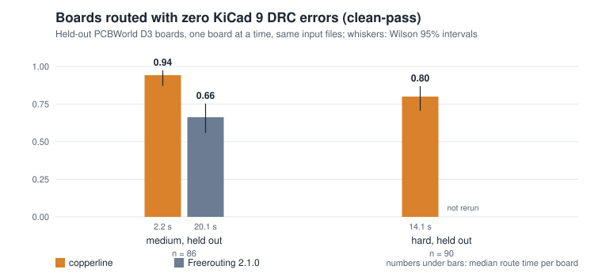

# copperline

A PCB autorouter written from scratch in Rust: it reads a KiCad 9 board, routes every
connection on a grid with negotiated congestion (PathFinder), checks the result against
exact copper geometry, and writes plain KiCad tracks and vias back into the file. It also
compiles to a 440 KB WebAssembly module, so the [browser demo](https://thewingthewong.github.io/copperline/web/)
routes boards on your machine with no server.


**Headline.** On real open-hardware boards it never saw during development, scored by
KiCad 9's own DRC, copperline routes **93% of medium boards clean against Freerouting's
63%**, with a median of 2.8 s per board against Freerouting's 30 s. (Hard tier and the
Freerouting side of it are still running: see the table.)



## Results

Every board below is a real open-hardware design from [PCBench](https://github.com/PCBench/PCBench),
prepared with [PCBWorld](https://github.com/LGAI-Research/PCBWorld)'s own pipeline (the D3 benchmark):
the original routing is stripped, each net keeps the width its designer used, and the
project's design rules come along in the `.kicad_pro`. Both routers get the same input files.
A board counts as **clean** only when KiCad 9's own DRC (`kicad-cli pcb drc`, error
severity) reports zero unconnected items and zero violations on the routed file. That is
PCBWorld's clean-pass definition. Freerouting 2.1.0 is run the way PCBWorld runs it
(`-mp 10`, headless, 1800 s cap), through KiCad's own DSN export and SES import.

| tier | boards | copperline clean | Freerouting clean | copperline median / p90 s | Freerouting median / p90 s | both clean | only copperline | only Freerouting |
|---|---:|---:|---:|---:|---:|---:|---:|---:|
| easy (seen in dev) | 96 | 96/96 = 1.00 [0.96, 1.00] | 81/96 = 0.84 [0.76, 0.90] | 0.4 / 2.2 | 22.1 / 63.6 | 81 | 15 | 0 |
| medium, held out | 81 | 75/81 = 0.93 [0.85, 0.97] | 51/81 = 0.63 [0.52, 0.73] | 2.8 / 18.6 | 30.1 / 541.3 | 50 | 25 | 1 |
| hard, held out | 23 | 19/23 = 0.83 [0.63, 0.93] | 16/23 = 0.70 [0.49, 0.84] | 18.8 / 121.3 | 149.0 / 1800.0 | 14 | 5 | 2 |

Clean-pass with a Wilson 95% interval, then median and 90th-percentile route time per board.
"both / only" count the boards each router got clean. **Partial:** the hard held-out tier
currently covers the boards both routers have finished; Freerouting needs up to 30 minutes
per hard board and its run is still going.

Where the boards fail (paired boards):

| router | tier | unconnected only | DRC violations | timeout / error |
|---|---|---:|---:|---:|
| copperline | easy (seen in dev) | 0 | 0 | 0 |
| freerouting | easy (seen in dev) | 10 | 4 | 1 |
| copperline | medium, held out | 5 | 1 | 0 |
| freerouting | medium, held out | 22 | 6 | 2 |
| copperline | hard, held out | 4 | 0 | 0 |
| freerouting | hard, held out | 2 | 0 | 5 |

copperline fails by leaving a connection out; it does not write copper it knows is illegal.
Freerouting's failures include clearance violations, shorts and track-width errors that it
writes into the board (51 violations on the boards above). copperline's one KiCad error in
the frozen run is a short on WordClock_v2: a plated through-hole pad whose layer list names
only F.Cu, which KiCad treats as copper on every layer and copperline did not. That is fixed
after the freeze (commit e597165, with a test), and the held-out numbers are left as the
frozen version produced them.

Three held-out boards side by side (left copperline, right Freerouting, same input file;
solid blocks are copper text, drawn as the boxes copperline keeps clear of):


Numbers come from `bench/results/summary.md`, which `python3 bench/report.py` regenerates
from the per-board CSVs in `bench/results/`. Times are the router's own wall time per
board on an 8 GB Apple M-series laptop, with the two routers running side by side. For
Freerouting this includes JVM start (about 1 s). DSN export and SES import are not
counted, and KiCad's DRC is not counted for either router.

### A note on the benchmark's splits

PCBWorld ships D3 as train and test splits, but they overlap. The easy test split is the
easy train split (99 of 99 boards identical), 7 of the 10 medium test boards and 8 of the
10 hard test boards are also in train. Anyone tuning on train and reporting on test is
reporting on boards they have seen. copperline was developed on the train pools, so before
writing any router code `bench/splits.py` sealed 86 medium and 92 hard train boards
(seed 20261110). Those sealed boards, plus the few test boards that are not in train, are
the **held-out** tiers above. They were routed once, by the commit tagged `bench-freeze`.
The easy tier was seen during development and is labelled that way.

5 of the 796 D3 board folders could not be rebuilt by the prep chain on this machine
(0001, 0002, 0030, 0564, 0647) and are left out for both routers.

## Try it

```sh
cargo install --git https://github.com/TheWingTheWong/copperline
copperline route board.kicad_pcb -o board-routed.kicad_pcb
```

The design rules are read from `board.kicad_pro` next to the board (net classes, track
widths, clearances, via sizes, board minimums). Without it, KiCad's defaults apply. The
output is the input file byte for byte, with the new `segment` and `via` items appended
before the final parenthesis, so it opens in KiCad 9 and diffs cleanly.

A board that ships with the repo:

```sh
cargo run --release -- route examples/mcu48.kicad_pcb -o /tmp/mcu48-routed.kicad_pcb --stats /tmp/stats.json
```

```
pitch 0.087 mm, 42 nets, 62/62 connections, 18 iterations, 544 tracks, 54 vias, 1267.9 mm, 11707 ms
```

`scripts/check_examples.sh` routes both bundled boards and scores them with `kicad-cli`
(both come back with zero violations and zero unconnected items).

Other commands: `copperline info` (what the parser saw), `copperline svg` and
`copperline render` (pictures of a board), `--frames DIR` on `route` (one image per
routing step; `scripts/animate.sh` turns them into the GIF above).

## How it works

**Parsing.** A small S-expression reader loads the `.kicad_pcb`: copper layers, nets,
footprints with pads (circle, rect, roundrect, oval, trapezoid, chamfered and custom pads,
each turned into exact shapes: points, capsules and polygons with a rounding radius), drill
holes, the board outline from Edge.Cuts (lines, arcs, circles, polygons, including those
inside footprints), rule-area keepouts, existing copper and copper text. Text is boxed
with the real advance widths of KiCad's stroke font, measured from pcbnew. A box twice
too wide once swallowed a bridge rectifier's pads.

**Rules.** Net classes and patterns, track widths, clearances, via sizes, copper-to-edge,
hole clearance and hole-to-hole come from the `.kicad_pro`, along with pad- and
footprint-level clearance overrides.

**Grid and masks.** Each copper layer becomes a grid (pitch from the narrowest
width + clearance, typically 0.06 to 0.1 mm). For every net class, a mask records per cell
whether a track centreline of that class may sit there: free, owned by one net (inside
that net's clearance halo, so only that net may pass), or blocked. The mask is built from
exact distances to the real shapes, inflated by half the track width, the larger of the two
clearances, and a margin of 0.71 of a grid step, which is the furthest a straight or
diagonal grid move strays from a cell centre. A second mask per class does the same for via
centres, across all layers and with hole rules.

**Pads.** A pad is reached through its rim cells, or through a short exact stub from the
pad centre to a nearby grid node. Fine-pitch pads (0.5 mm QFP, QFN, FPC and USB-C rows)
leave straight along their axis before bending onto the grid, because an angled stub
clips the neighbouring pads. Every stub is checked against the exact geometry before it
is offered to the search.

**Routing.** Each net is grown as an approximate Steiner tree: a multi-source A* runs from
everything already connected to the nearest unconnected pad, with 8-way moves, through
vias between layers, a mild per-layer direction preference and a bend cost. The search
stays inside a window around the connection first, with a heuristic weight of 1.25.

**Negotiation.** In the first pass, nets may overlap. Every routed net stamps a halo into
an occupancy grid per net class. After each pass, a cell used by more than one net raises
its history cost, the present-congestion factor grows (capped), and only the nets in
conflict are ripped up and rerouted. This repeats until nothing overlaps (McMurchie and
Ebeling's PathFinder, 1995). If it stalls, the remaining nets are rerouted with other nets'
halos as hard walls.

**Last word: exact DRC.** The result is checked segment by segment against pads, holes,
existing copper, the board edge, keepouts and the other new copper, using the exact
distance functions. A net that still violates is rerouted strictly or left unrouted, so
copperline never writes a violation it knows about. When a board ends up incomplete, the
whole route is retried on a finer grid (0.6x, then 0.4x pitch) within one time budget.

**Writing.** Grid paths become straight runs (collinear moves merged, breakpoints kept
where another branch joins), then KiCad `segment` and through `via` items with fresh UUIDs.

## Testing

`cargo test` covers the distance kernel against dense sampling (randomised), the
S-expression reader, rules and wildcard net-class patterns, the writer, and the router on
generated boards. Random two-layer boards and a 0.5 mm-pitch QFN-24 fan-out must come back
with zero violations under copperline's DRC. Every net the router reports as complete must
also be connected according to an independent connectivity check that follows KiCad's rules,
and the output must strip back to the input byte for byte.

On real boards KiCad is the judge. Every result in `bench/results/` was scored by
`kicad-cli`. The pad parser is also checked directly against KiCad: `bench/check_parser.py`
has pcbnew dump every pad's own copper polygon and requires each vertex to lie inside
copperline's shape (`bench/results/parser-*.txt`).

## Reproducing the benchmark

```sh
git clone https://github.com/PCBench/PCBench            # ~1.2 GB of open-hardware boards
git clone https://github.com/LGAI-Research/PCBWorld pcbworld   # its BSD-3 prep chain
PCBENCH=PCBench PCBWORLD=pcbworld D3_ROOT=$PWD/d3 bench/prepare.sh
D3_ROOT=$PWD/d3 python3 bench/run.py --split sealed-b --router copperline
D3_ROOT=$PWD/d3 FREEROUTING_JAR=freerouting-2.1.0.jar python3 bench/run.py --split sealed-b --router freerouting
python3 bench/report.py
```

`bench/run.py` needs KiCad 9 (`KICAD_CLI`, and `KICAD_PYTHON` for a Python that imports
`pcbnew`), Java for Freerouting (`JAVA`), and runs one board at a time so it fits on a
small laptop. It resumes where it stopped. Board files are never committed here; the
splits are in `bench/splits.json`.

## Limitations

- Grid routing: tracks run at 0/45/90 degrees between grid nodes. There is no any-angle
  routing, no push-and-shove, and no pull-tight pass yet, so routes have more bends than a
  person would draw.
- Through vias only (no blind or buried vias). No differential pairs, length matching or
  impedance control. Copper pours are treated as fixed obstacles and are not created.
- On fine-pitch parts in tight spots (USB-C receptacles, FPC connectors) the grid sometimes
  cannot find a legal entry and leaves a connection unrouted. That is where most of the
  held-out failures above come from.
- copperline reads a `.kicad_pcb` the way KiCad 9 writes it. Older files should be opened
  and saved once in KiCad 9 first.
- Hard boards can take minutes, because A* floods behind large blocked areas. The default
  time budget is 90 s per board, after which copperline writes what it has, legal but
  possibly incomplete.
- The browser demo runs the same code single-threaded; dense boards take a while there.

## References

- L. McMurchie and C. Ebeling, "PathFinder: A Negotiation-Based Performance-Driven Router
  for FPGAs", FPGA 1995.
- Song et al., "PCBWorld: A Benchmark Environment for Engine-Grounded PCB Design Automation",
  KDD 2026 workshop, [arXiv:2607.05915](https://arxiv.org/abs/2607.05915),
  [code](https://github.com/LGAI-Research/PCBWorld): the D3 benchmark and its prep chain
  (BSD-3), used here unchanged.
- [PCBench](https://github.com/PCBench/PCBench): the open-hardware board collection.
- [Freerouting](https://github.com/freerouting/freerouting): the baseline router.
- KiCad 9 file format and `kicad-cli` DRC: the ground truth for every number here.

## License

MIT, see [LICENSE](LICENSE).
